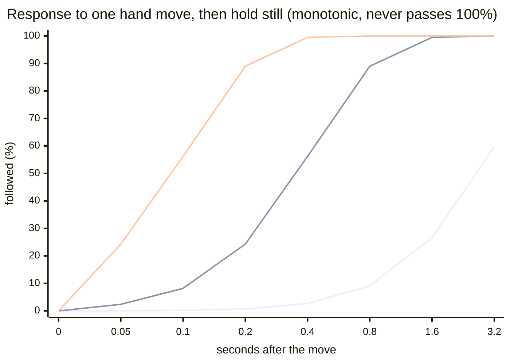

# Borderlands 2 VR — Two-Handed Grip + Aim Smoothing

A DLL-proxy mod for **Borderlands 2 VR** (Steam AppID 991260, version 1.0.462.2101248).

Two features, driven by your controller buttons (both changeable in the ini):

1. **Two-handed grip** — while you hold the **grip button** (default) the gun aims along the
   **line between your two hands**. Your hands stay completely free to slide back and forth along
   the grip; only the *aim direction* is locked to the line. Move the off-hand and the gun rotates
   with it. The button always belongs to the **hand holding the gun**, so normal and lefty layouts
   both work.
2. **Rotation smoothing** — your hand poses are run through a One Euro filter, so the small
   tremble that ruins long-range shots is removed. It gets much heavier while the **index trigger**
   (the zoom bind) is held — that is the setting that matters for snipers.

Works in **normal and lefty layouts** (see `gun_hand`).

---

## Install

1. In `...\Borderlands 2 VR\Binaries\Win64\`:
   - copy the game's original `openvr_api.dll` to **`openvr_api_orig.dll`** (keep it — our proxy
     forwards to that name),
   - put **our `openvr_api.dll`** and **`bl2vr_grip.ini`** in the same folder.
2. Launch the game **through Virtual Desktop** (VD → Games).

**Uninstall:** copy `openvr_api_orig.dll` back over `openvr_api.dll` and delete `bl2vr_grip.ini`.

> **Important:** launching this game through SteamVR crashes it (a pre-existing game/runtime
> incompatibility, reproducible with the untouched original DLL). Use Virtual Desktop.

---

## How it works (short version)

- On this setup BL2VR does **not** run on OpenVR — it runs on **Virtual Desktop's Oculus runtime**
  (`VirtualDesktop.LibOVRRT64_1.dll`). Verified from the loaded-module list in-game.
- The game **always** loads `openvr_api.dll` from its own folder, so that file is our way in: our
  DLL forwards every OpenVR export to the original and hosts the payload.
- A worker thread waits for VD's Oculus runtime to appear, then installs a **MinHook** detour on
  **`ovr_GetTrackingState`**, the call the game uses to read controller poses.
- Each call: optionally apply the two-hand solve, then run both hand poses through the filter.
- All struct layouts were taken from the generated Oculus SDK bindings (not guessed) and then
  **confirmed against a raw dump of the live tracking state** on real hardware.
- A built-in **jitter meter** prints how much the right-hand rotation actually moved per call,
  raw vs filtered, so improvements are measured rather than guessed.

Log file: `Binaries\Win64\openvr_proxy.log` (or `%LOCALAPPDATA%\BL2VR-grip\openvr_proxy.log`).

---

## How the two-hand solve works

```
forward = normalize(offhand_position - gunhand_position)
```

The gun hand's orientation gets a **delta rotation** that points its barrel axis along that line.
Because it is a delta on top of the raw pose, the game's own per-weapon "how the gun sits in the
hand" offset is preserved. **Positions are never modified.**

---

## Config — `bl2vr_grip.ini`

**This file is re-read every 2 seconds while the game runs.** Edit it mid-session and the change
applies within a moment — no restart needed.

### Smoothing
| Key | Default | Meaning |
|---|---|---|
| `enabled` | 1 | master switch |
| `smooth_hands` | 1 | smooth both hand poses |
| `smooth_head` | 0 | smooth the head pose — usually bad (view lag) |
| `min_cutoff` | 5.0 | position: lower = steadier at rest, laggier |
| `beta` | 2.0 | position: higher = responds sooner when you move |
| `min_cutoff_rot` | 3.0 | rotation: same idea, for rotation |
| `beta_rot` | 1.2 | rotation equivalent of `beta` |
| `predict_ms` | 0 | extra motion prediction (0 = off) |

### Zoom (trigger) gate
| Key | Default | Meaning |
|---|---|---|
| `trigger_gate` | 1 | 0 = ignore trigger, 1 = stronger while held, 2 = smooth **only** while held |
| `trigger_threshold` | 0.5 | how far the trigger must be pulled |
| `zoom_mult` | 20.0 | position is this many times smoother while zoomed |
| `zoom_mult_rot` | 60.0 | rotation equivalent (3× the position value) |

> Both the cutoff **and** `beta` are divided by these, so zooming makes the filter uniformly
> heavier — a smooth "slide", not added responsiveness.

### Two-handed grip
| Key | Default | Meaning |
|---|---|---|
| `twohand` | 1 | enable the feature |
| `twohand_gate` | 1 | 1 = only while the button below is held (recommended), 0 = always on |
| `twohand_button` | grip | which button engages two-hand mode: `grip` (recommended — the index trigger is also the game's pickup button) or `trigger` |
| `twohand_hand` | offhand | which **controller** owns that button: `offhand` (the hand *not* holding the gun — recommended, because on the gun hand the grip is the game's **reload** bind) or `gun`. Follows `gun_hand` automatically. |
| `gun_hand` | right | **which hand holds the gun**: `right` normal, `left` for lefty mode |
| `aim_axis` | -z | which local axis of that hand points down the barrel: `+x -x +y -y +z -z` |
| `twohand_min_dist` | 0.12 | don't engage if the hands are closer than this (metres) |
| `twohand_max_dist` | 0.75 | …or further apart than this |
| `twohand_blend` | 1.0 | 0..1, how hard to snap to the line (1 = fully locked) |

#### Two-hand-only filter profile
While two-hand mode is active it uses its **own** filter settings, because two hands on the gun
means much less input noise. The idea is *very steady at rest, still fast enough to track*:

| Key | Default | Meaning |
|---|---|---|
| `twohand_min_cutoff` | 0.8 | smoothing on the hands while two-handing |
| `twohand_beta` | 1.0 | one-euro speed term (higher = catches up sooner) |
| `twohand_min_cutoff_rot` | 0.4 | rotation equivalent |
| `twohand_beta_rot` | 0.6 | rotation equivalent |

**These two blocks never combine.** While two-hand mode is active, the two-hand block *replaces*
the trigger/zoom block entirely — so a pistol one-handed (trigger only) keeps its own tuning, and
two-hand mode has its own. Set `twohand_min_cutoff_rot=0` to make two-hand fall back to block 1.

---

## How the smoothing works

It is a **second-order critically damped follower** — the same primitive as Unity's `SmoothDamp`
(Game Programming Gems 4):

```
acc = w^2 * err - 2*w * v          w = 2 / smoothTime          zeta = 1
```

A plain low-pass is **not** smooth, and that was a real bug: it reaches its maximum speed in the
very first frame. Velocity jumps 0 → max instantly, which is infinite acceleration — a kick at the
start and a hard corner on arrival. That reads as "laggy", not "smooth".

Here the follower keeps its **own velocity**, which starts at **zero**, ramps up, peaks, then
decays as it lands. That is the S-curve, and it is what "smooth" actually means.



Series: **0.05 Hz** (drift), **0.375 Hz**, **1.5 Hz**. Note the flat start on every curve — that
is the velocity ramping from zero.

**It cannot overshoot.** `zeta = 1` (critically damped) is the fastest response that does not
overshoot, and Unity's closed-form `exp()` solution is used instead of raw integration so it stays
stable and frame-rate independent at any frame rate. Measured over a full step response at both
90 Hz and 163 Hz: peak = exactly 1.000000, overshoot = 0.

`predict_ms` stays `0`. Extrapolation is the only thing in a chain like this that *could* overshoot.

### Tuning

`min_cutoff` still means the same thing, and maps to seconds: `smoothTime = 1/(2*pi*cutoff)`.
What you actually feel is the **settle time**: `settle(95%) ≈ 2.4 × smoothTime ≈ 0.38 / cutoff`.
(A second-order follower is slower to *arrive* than a first-order one at the same smoothTime —
that factor is real, the earlier table omitted it.)

| cutoff | smoothTime | settle (95%) | feel |
|---|---|---|---|
| 0.05 Hz | 3.18 s | ~7.6 s | drifts away |
| 0.4 Hz | 0.40 s | ~0.95 s | heavy |
| 1.0 Hz | 0.16 s | **~0.38 s** | strong but trackable ← trigger / two-hand default |
| 3.0 Hz | 0.05 s | ~0.13 s | light, always-on base smoothing |

### The dt bug that made everything feel like molasses

For most of this project the follower was stepped with `dt=0.0001` — not a real interval, the
old clamp floor. The game calls `ovr_GetTrackingState` in bursts from more than one thread, so
the raw per-call QPC delta was meaningless and almost every step got the 0.1 ms floor: the
follower's clock ran ~55× slower than real time. **Every** profile collapsed into the same
molasses, which is why no amount of tuning ever felt different and the trigger's multiplier was
unmeasurable (3.3× vs 3.1× smoother with the trigger held vs not).

`dt` now comes from the **average call rate** (consecutive deltas telescope, so their running
mean *is* the true interval), guarded against the two-thread race. Verify in
`openvr_proxy.log`: `dt=` must read ~0.005–0.006, never 0.0001.

`beta` stiffens the spring smoothly as the gun picks up speed (no threshold, so nothing to
toggle). Higher `beta` = catches up sooner on a fast sweep, at the cost of some of the weight.

### Do not add a speed/error threshold

The one thing that must not come back is a **threshold that switches the filter on and off** (a
"bubble"). Tracking a moving enemy puts the hand speed right on top of any such threshold, so it
toggles several times a second — and every toggle is a lurch, plus a "boat" feeling on the way in
because the release has to ramp before it does anything. There is no smooth way to switch; only
not to switch.

A single always-on interpolator has no state to flip, so it has no jerk. It also cannot *cancel*
another profile's smoothing the way a release floor does (that is what made "trigger only" feel
unsmoothed).

> Reference values from elsewhere: Meta's Interaction SDK ships its wrist-rotation one-euro
> filter at `minCutoff 2.0 Hz, beta 3.0` — the 0.05 Hz we were using earlier is 40× heavier than
> a production rotation filter.

Set `twohand_min_cutoff_rot=0` to fall back to the normal zoom profile.
**Tuning rule of thumb:** smoother at rest → lower the `min_cutoff`s. Better tracking while
rotating → raise the `beta`s. They are independent, which is the whole point of this filter.

---

## Calibration: if the gun points the wrong way

`aim_axis` is the barrel direction in the controller's own frame, and it can differ per game
version / controller. There is a built-in helper:

1. Set `twohand=1` and `twohand_gate=0` (always on) for the test.
2. Hold the gun with both hands and **point it at a target**.
3. Read the log — roughly every second it prints:
   ```
   twohand: ACTIVE gun_hand=left using axis -z | best-matching axis=+z (0.998) <- if this is not the axis above, change aim_axis
   ```
4. Set `aim_axis` to whatever `best-matching` says.

If `best-matching` is negative (e.g. `-0.5`), flip the sign. Take the reading **while you are
actually aiming at something** — that is when the hand-to-hand line and the barrel agree.

---

## Known limitations

- **Positions are never modified** — by design, so you can slide your hands along the grip.
- **SteamVR launch is broken** for this game (see above); Virtual Desktop is required.
- The first sample after enabling has no filter history, so it starts from the raw pose.
- Per-weapon differences (how a gun sits in the hand) may want a different `aim_axis` or a
  lower `twohand_blend`.
- Built with AI assistance.

## Credits / prior art

Implemented at the Oculus runtime boundary using [MinHook](https://github.com/TsudaKageyu/minhook).
Same class of tool as OpenVR-InputEmulator / gun-stock "motion compensation", but placed at the app
boundary so it does not fight the runtime. I could not find an existing two-handed-grip mod for
this game — that is "I couldn't find one", not a claim to be the first.
