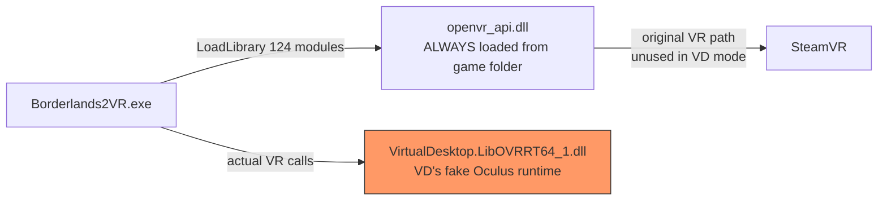
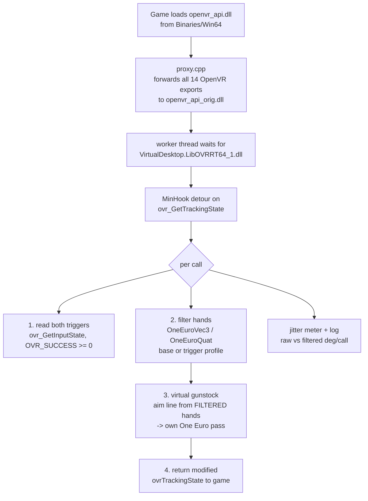

# Architecture — how the mod gets between the game and the VR runtime

**Target:** Borderlands 2 VR (Steam 991260, exe 1.0.462.2101248, UE3/WillowGame, x64).
**Shipped route:** "Route A hybrid" — an `openvr_api.dll` proxy as the *carrier*, a MinHook
detour on the **Oculus** tracking call as the *payload*.

## The key discovery

The plan assumed the game reads poses through SteamVR/OpenVR. It does not — on a Virtual
Desktop setup the game runs in **Oculus (LibOVR) mode**, served by Virtual Desktop's fake Oculus
runtime:

Evidence: a 50-second in-game module snapshot showed `VirtualDesktop.LibOVRRT64_1.dll` as the
only VR runtime loaded; the registry `ActiveRuntime` pointed at VDXR; the exe contains 72
`ovr_*` strings and a `ProteaSeqCond_SwitchVRPlatform` selector. Full forensics: [DEVLOG.md](DEVLOG.md)
sessions 1b–1f.

## The shipped pipeline

Design rules that fell out of testing (see [README](../README.md#how-the-smoothing-works)):

- **Smoothing is the base of everything** — the stock line is derived from already-filtered hands.
- **Positions are never rewritten** — only orientation, so hands slide freely on the grip.
- **Delta application** — the solve is applied as a delta on top of the raw pose, so the game's
  per-weapon grip offsets survive.
- **No thresholds anywhere** — a speed/error "bubble" toggled several times a second while
  tracking a moving target; every toggle was a lurch. Always-on interpolation only.
- **`dt` from QPC deltas telescoping** — the game polls in bursts from multiple threads; per-call
  deltas average out correctly over a second (details in the [tuning doc](TUNING.md)).

## Open technical question: one filter, several prediction timelines

`ovr_GetTrackingState(session, absTime, ...)` returns poses **predicted to `absTime`**. The game
calls it from more than one thread, and different callers may pass different `absTime` values —
so consecutive samples fed into the single filter state can come from *different prediction
timelines*, not just tiny steps on one clock (the telescoping argument covers only the clock).
The periodic log line prints `t=` (the `absTime` each call asked for) so this can be checked
against real data. If the jitter meter ever shows odd behavior, the candidate fix is to key the
filter state per calling thread (TLS), or to only filter the main game-thread call and pass the
rest through raw. Not implemented yet — no observed symptom on the tested setup.

## Layout validation

Oculus struct sizes are `static_assert`-checked against the SDK bindings
(`ovrPosef`=28, `ovrPoseStatef`=96, `ovrTrackingState`=328 bytes) **and** confirmed against a raw
memory dump of live tracking data on real hardware. Nothing was guessed.

## Component map

| Path | Role |
|---|---|
| `openvr_proxy/src/proxy.cpp` | The carrier: 14 OpenVR exports forwarded via explicit C++ wrappers (MSVC `.def` forwarders are broken, LNK2001) |
| `openvr_proxy/src/ovrhook.cpp` | The payload: waits for the OVR runtime, installs the detour, runs filter + gunstock, logging |
| `openvr_proxy/src/filters.h` | One Euro (vec3 + quat) with optional catch-up term; the same header feeds the offline bench |
| `openvr_proxy/install.ps1` | Install/restore with backup |
| `tools/imguipanel/` | Desktop launcher/patcher + live config editor (ImGui) |
| `tools/filter_bench.cpp` | Offline numerical harness — runs the *real* `filters.h` on synthetic motions |
| `tools/ovr_proxy_legacy/` | Abandoned standalone `LibOVRRT64_1.dll` proxy (128 MASM jump stubs). Kept as reference; the game would not load it, so the payload moved into the openvr carrier |
| `research/` | Raw export lists discovered during recon |

## Why not the other routes?

| Route | Verdict |
|---|---|
| B: unrealsdk injection | never needed — Route A worked |
| C: native hook in the exe (Ghidra) | never needed; more fragile, harder to distribute |
| D: on-disk exe patch | last resort; rejected — we touch zero game files |
| Standalone `LibOVRRT64_1.dll` proxy | built (128/128 exports, identical set) but the game wrote no log when it was installed — payload moved into the always-loaded `openvr_api.dll` carrier |
